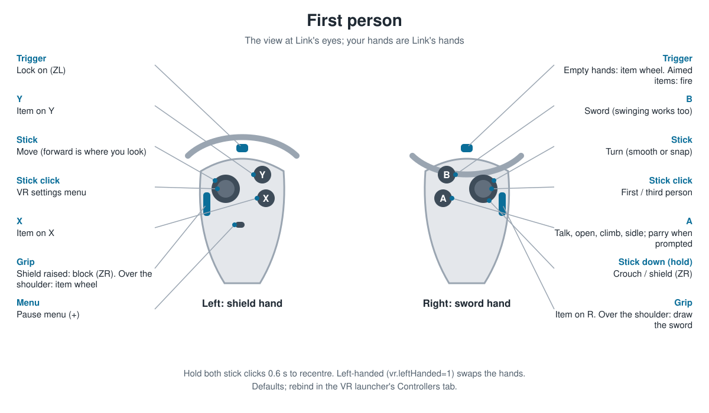
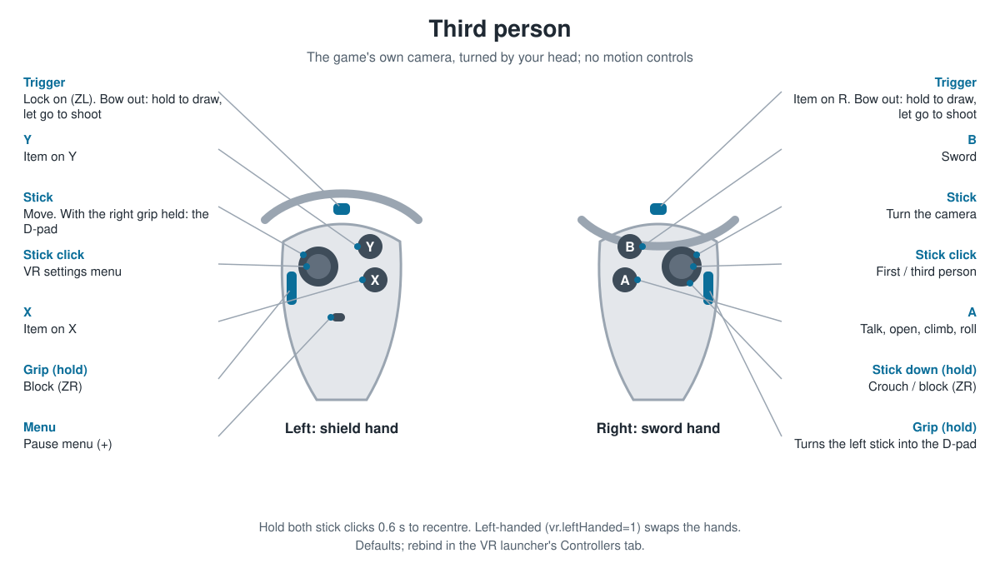
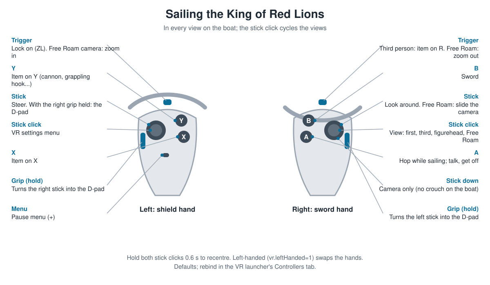

# Playing Wind Waker HD in VR: launcher, controls, sword and item wheel

How to start **VR-WakerHD** (the VR version of *The Legend of Zelda: The Wind Waker HD*) with its VR launcher, and how
the motion controls work: the controller mapping in first person, third person and on the boat, the physical sword,
and the shoulder-reach item wheel. Every setting is listed in [VR_SETTINGS.md](VR_SETTINGS.md); the full controls
reference is [VR_CONTROLS.md](VR_CONTROLS.md).

## Starting VR with the launcher

The launcher, `wwhd-vr-launcher` (Windows: `wwhd-vr-launcher.exe`, titled "Wind Waker HD VR"), sets the VR options
and starts the game, on the desktop or in VR. It is optional: `wwhd --vr` starts VR without it.

1. Start your OpenXR runtime and make it the active one (SteamVR: Settings > OpenXR > "Set SteamVR as OpenXR
   runtime").
2. Start `wwhd-vr-launcher` from the build folder, next to `wwhd`. It finds the game there.
3. In **General**:
   - **OpenXR** shows the active runtime. **Check for a headset** starts the runtime briefly and asks it for a headset.
   - **Game program** is filled in when the game is next to the launcher; otherwise enter the path of `wwhd(.exe)`.
   - **Game files (--game)**: see the next section.
4. Set what you like in the **Camera and comfort**, **Controllers** and **Graphics** tabs. Nothing is written until
   **Save** (or Play, which saves first).
5. Press **Play VR**, or **Play Flat**. **Start in VR (also without the launcher)** makes every start a
   VR start (`vr.enabled=1`).

The headset shows the game; the desktop window mirrors the left eye.

Without the launcher:

```bash
wwhd --vr --game <game folder>
```

Check the VR path without any game files. The headset shows a colour per eye for about 3 s and the controllers
vibrate once; `[vr smoke] PASS` means the loader, runtime, Vulkan binding, swapchains and frame loop work:

```bash
WWHD_VR=1 ./build/mingw/wwhd.exe --renderer-smoke
```

## Setting the game location in the launcher

The launcher needs the **extracted game folder**, not the disc image: the folder that holds `code`, `content` and
`meta` after [preparing your game](BUILDING.md#prepare-your-game-all-platforms). In the **General** tab, enter it under **Game
files (--game)**. The launcher passes it to a source build as `--game <folder>`.

- It is kept between starts in `vr-launcher.ini` (`launcher.gameDir`), in the game's settings folder:
  `%APPDATA%\WWHD` on Windows, `~/.config/wwhd` on Linux. **Open the settings folder** opens it.
- To change it, edit the field and **Save**.
- **Not recognised:** if the folder is wrong or the game does not match the recompiled code, the game does not
  start, and the launcher says it ended right after starting. The game's log says why, for example
  `cannot load game/code/cking.rpx`. The game must be the same dump that `build/gen` was recompiled from.

## Controller mapping

The controllers become the Wii U GamePad's buttons and sticks, so every action works as the game decides. The
**sword hand** is the right controller and the **shield hand** the left; **Left-handed** (`vr.leftHanded=1`) swaps
them. These are the defaults (`runtime/src/vr/vr_bindings.h`); change them in the launcher's **Controllers** tab or
with `vr.bind.<action>=<button>`. Buttons are named as on Quest / Rift Touch controllers; on PS VR2 Sense, Cross is A,
Circle B, Square X and Triangle Y. The controls change with the view: **first person**, **third person** and **on the
boat**.

### Everywhere

| Input | Does |
|---|---|
| Left stick | move (forward is where you look; `vr.moveDirection=hand`: where the left controller points) |
| Right stick left / right | turn: smooth (default) or snap (30°, `vr.turn`) |
| Right stick click | switch the view: first / third person (on the boat: four views, below) |
| Left stick click | the VR settings menu in the headset (the game pauses) |
| Both stick clicks held 0.6 s | recentre |
| A / B | A (talk, open, pick up, climb) / B (sword) |
| X / Y | the item on X / on Y |
| Left trigger | lock on (ZL) |
| Menu button (left controller) | pause menu (+), on the GamePad panel in front of you |
| Head | the view: rotation and position |

The Valve Index has no menu button: bind "Menu" in SteamVR's binding editor.

### First person



Your hands are Link's hands: the arms follow the controllers, and the sword and shield are held in them.

| Input | Does |
|---|---|
| Swing the right controller | sword attack: down, left to right or right to left; the blade hits along its path |
| Right grip over the right shoulder | draw the sword (B also draws it) |
| Right grip | the item on R |
| Right trigger | with empty hands: the item wheel (hold, right stick to choose, let go to take it out); with an aimed item: fire |
| Left grip held over the left shoulder | the item wheel (right stick to choose, push the hand forward to take it out) |
| Raise the shield (left hand up) | lock onto the nearest enemy; locked on, Link guards by himself |
| Raised shield + left grip | block (ZR), when nothing is locked on |
| Right stick down (hold) | crouch / shield (ZR) |
| A when the parry prompt shows | parry: the game rolls you around the enemy, your swing makes the finishing cut |
| A at a wall when "Sidle" shows | sidle along the wall |
| Point the hand holding it | aim the bow, hookshot or boomerang; the bow is drawn with your other hand, a trigger shoots |
| Hold your hands up / down / left / right | conduct the Wind Waker (the sticks work too) |

### Third person



The game's own camera, turned by your head. There are no motion controls: buttons and sticks work as on the GamePad,
and the sword attacks with B.

| Input | Does |
|---|---|
| Left stick | move Link, relative to the camera |
| Right stick left / right | turn the camera |
| Right stick down (hold) | crouch / block (ZR) |
| Left grip (hold) | block (ZR) |
| Right grip (hold) + left stick | the **D-pad** (see below); Link stands still meanwhile |
| Right trigger | the item on R |
| Either trigger, bow out | hold to draw, let go to shoot |
| B | sword |

### On the boat (the King of Red Lions)



While Link sails, in every view:

| Input | Does |
|---|---|
| Left stick | steer |
| A | hop (while sailing); also talk, get off, hold to stop |
| Right stick click | cycle the views: first person → third person → **figurehead** (on the King of Red Lions' head) → **Free Roam camera** → first person |
| Right stick | look around (it never crouches on the boat) |
| Right grip (hold) + left stick | the **D-pad**; the boat is not steered meanwhile |
| Left grip (hold) + right stick | the **D-pad** too; the camera stays still meanwhile |
| Right trigger | third person: the item on R; first person / figurehead with empty hands: the item wheel |
| X / Y / R | the items on them: cannon, grappling hook (salvage), bow, boomerang |
| Free Roam camera | left trigger zooms in, right trigger zooms out, right stick slides the camera |

Taking out the bow, hookshot or boomerang in the figurehead or Free Roam view switches to first person, so you can aim
with your hands; click back to a boat view afterwards. Leaving the boat returns to third person.

### The D-pad

The Wii U GamePad's D-pad has no button of its own on VR controllers, so a grip turns a stick into it: **hold the
grip, then push the stick** up, down, left or right (past half way; its strongest direction counts). Let go of the
grip and the stick moves (or steers) again. **D-pad up plays the Wind Waker**; the other directions do what the game
gives them.

| Where | D-pad |
|---|---|
| Third person, on foot | right grip + left stick |
| On the boat (any view) | right grip + left stick, or left grip + right stick |
| Third person, in events and menus | the right grip alone presses D-pad up |
| First person, on foot | not on a grip (the grips close Link's hands); switch to third person, or bind a button to `Up` / `Down` / `Left` / `Right` in the launcher |

Full reference: [VR_CONTROLS.md](VR_CONTROLS.md), [VR_CONTROL_MAPPING.md](VR_CONTROL_MAPPING.md),
[VR_SAILING_VIEWS.md](VR_SAILING_VIEWS.md). The diagrams are drawn by `tools/docs/controller_diagrams.py`.

## Motion controls and physical interactions

- **Head:** rotation and position drive the view at Link's eyes. Leaning is followed up to `vr.maxHeadOffset` (default
  0.45 m). Recentre with both stick clicks.
- **Hands:** each of Link's arms follows the controller on its side by IK, and the hand turns as the controller does.
  Through a tracking gap up to 2 s, the last tracked pose is held.
- **Body:** standing still in first person, Link turns to face where you look past 30° *(new)*. Walking, he faces
  where he walks; lock-on, attacks and events keep the game's own facing.
- **Sword and shield:** the sword at the sword hand, the shield on the shield hand *(the shield's orientation fix is
  new)*.
- **Shoulder reaches:** over the sword hand's shoulder (with the grip) draws the sword; over the shield hand's
  shoulder (with the grip held) opens the item wheel. The two shoulders are kept apart: neither gesture starts the
  other.
- **Wrist displays:** hearts and the item / B buttons on the left wrist, rupees on the right. Each shows while you
  look at it with its face turned to you.
- **Ladders** *(new)*: climbing down, the view turns to Link's facing; the head looks around freely.
- **Haptics:** sword hits vibrate (`vr.hapticStrength`), as do the item wheel's steps and choice.

## The physical sword

1. **Draw:** reach over the **sword hand's** shoulder (the right one; the left when left-handed) and **press** its
   grip. Pressing B also draws it, as in the game, with its draw slash. The draw's slash never hits.
2. **Hold:** the sword sits in Link's hand and points where the controller points. **Sword tilt** sets the blade's
   angle, and **Sword wrist straight** keeps the wrist in line with the forearm.
3. **Attack:** a **full swing** (down, left to right, or right to left) presses the game's attack. The game picks the
   cut, combos and damage, and the hit capsules follow your tracked blade. Thrusts, upward swings, wind-ups and wrist
   turns do not attack. Sensitivity is in the launcher's **Controllers > Swing sensitivity**.
4. **Physical sword** *(new)*: while the sword hand swings, the blade also cuts grass and hits enemies along its path
   without Link's attack animation (**Physical sword**, `vr.physicalSword`).
5. **Hits** vibrate the sword hand, once per target per swing.
6. **Sheathe:** as in the game, with A ("Put Away"). There is no sheathing gesture, because A also talks and rolls.
7. **While sheathed:** swings do nothing.

Third person plays as on the GamePad, with no swing detection.

## The item wheel

1. **Open:** put the **shield hand** (the left one; the right when left-handed) over its shoulder and **hold its
   grip**.
2. **Choose:** **right stick** left / right moves around the ring; up / down changes the page (Items, Spoils Bag,
   Bait Bag, Delivery Bag). Holding the stick repeats, and letting go keeps the choice.
3. **Take it out:** **pull the hand forward**. The item goes on **X** (`vr.itemWheelButton`: X, Y or R), and that
   button is pressed for you, so Link takes it out.
4. **Cancel:** let go of the grip at the shoulder, click the right stick, or lower the hand to your side.


Details: [VR_ITEM_WHEEL.md](VR_ITEM_WHEEL.md).

See also: [INSTALLATION.md](INSTALLATION.md) · [COMPATIBILITY.md](COMPATIBILITY.md) · [FAQ.md](FAQ.md) ·
[back to the README](../README.md)
